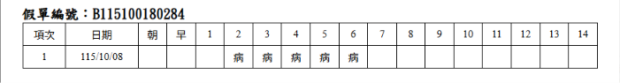

# 計算機結構 -- 作業總覽（nand2tetris）


每週檢驗表格

第幾週 |  習題內容 | 有上課且準時繳交 |  補交且附上請假證明 | 作業連結
-------|----------|--------------------|---------------------|-------------
3          | 第 1, 2 章   |   是 |   | [01](https://github.com/vicky111410524/_co/tree/main/01), [02](https://github.com/vicky111410524/_co/tree/main/02) [圖片](https://github.com/ccc115a/_co/issues/3#issuecomment-5806910092)
4          | 第3 章除 PC | 是 |      |  [03](https://github.com/vicky111410524/_co/tree/main/03) | 
5          | 第 4 章 | 是 | 是  |  [04](https://github.com/vicky111410524/_co/tree/main/04) | 
6          | HackCPU 電路圖 | 是 |  | [電路圖](https://github.com/ccc115a/_co/issues/11#issuecomment-6183797093)| 
7          | 第 5 章 | 是 |  |  [05](https://github.com/vicky111410524/_co/tree/main/05) | 
8          | EDA 軟體報告 | 是 |   | [HW8](https://github.com/vicky111410524/_co/tree/main/HW8)| 


> 本課程以 [nand2tetris](https://www.nand2tetris.org/) 教材為主軸，從 Nand 閘開始，
> 逐層建構邏輯閘、ALU、記憶體、CPU，最後完成 Hack 電腦。
> 本倉庫的 `01`～`05` 對應 nand2tetris Projects 1～5，`HW8` 為 EDA 專題。

| 欄位 | 內容 |
| :--- | :--- |
| 學期 | 115 學年上學期 |
| 教師 | [陳鍾誠](https://www.nqu.edu.tw/educsie/index.php?act=blog&code=list&ids=4) |
| 學校 | [金門大學資訊工程系](https://www.nqu.edu.tw/educsie/index.php) |
| 學生 | 許毓庭 |
| 學號 | 24 |

---

## 作業對照總表

| 作業 | 主題 | 對應 nand2tetris 專案 | 目錄 |
| :--: | :--- | :--- | :--- |
| 作業三 | 布林邏輯 + 布林算術 + 手繪 ALU 電路圖 | Project 01、Project 02 | `../01/`、`../02/` |
| 作業四 | 循序邏輯（所有習題） | Project 03 | `../03/a/`、`../03/b/` |
| 作業五 | 機器語言（所有習題） | Project 04 | `../04/mult/`、`../04/fill/` |
| 作業六 | Hack CPU 電路圖（含邏輯式與符號對應表） | Project 05 前置設計 | `../05/`（文件） |
| 作業七 | CPU + Memory + Computer（所有習題） | Project 05 | `../05/` |
| 作業八 | EDA 軟體應用與晶片設計流程實作 | HW8 | `../HW8/` |

### 檔案命名規則

| 副檔名 | 說明 |
| :--- | :--- |
| `.hdl` | 以 HDL 撰寫的晶片實作 |
| `.tst` | 硬體模擬器測試腳本 |
| `.cmp` | 測試的期望輸出（compare file） |
| `.out` | 實際執行後產生的輸出紀錄 |
| `.asm` | Hack 組合語言原始碼 |
| `.hack` | 組譯後產生的 16-bit 機器碼 |

測試方式：使用 `nand2tetris/tools/HardwareSimulator.bat` 載入 `.hdl` 與 `.tst`，
執行後比對 `.cmp`，成功時顯示 `Comparison ended successfully`，並留下 `.out` 紀錄。

---

## 作業三：布林邏輯、布林算術與 ALU

### 1. 布林邏輯（Project 01，`../01/`）

以 `Nand` 為基礎，實作所有基本與多通道邏輯閘：

| 類別 | 晶片 |
| :--- | :--- |
| 基本閘 | `Not`、`And`、`Or`、`Xor` |
| 多工／解多工 | `Mux`、`DMux` |
| 16-bit 版本 | `Not16`、`And16`、`Or16`、`Mux16` |
| 多通道版本 | `Or8Way`、`Mux4Way16`、`Mux8Way16`、`DMux4Way`、`DMux8Way` |

實作重點：
- `And(a, b) = Not(Nand(a, b))`
- `Xor(a, b) = (a And Not b) Or (Not a And b)`
- `Mux` 以 `sel` 選擇 `a` 或 `b`；`DMux` 反向將 `in` 分配到指定輸出。
- 多通道版本以「先分組、再兩層選擇」的方式由 2-way 元件組合而成
  （例如 `Mux8Way16` = 兩個 `Mux4Way16` + 一個 `Mux16`）。

每個晶片皆附 `.tst` 測試腳本、`.cmp` 期望輸出與 `.out` 實際輸出。

### 2. 布林算術（Project 02，`../02/`）

| 晶片 | 功能 |
| :--- | :--- |
| `HalfAdder` | 1-bit 相加：`sum = Xor(a,b)`、`carry = And(a,b)` |
| `FullAdder` | 3-bit 相加（兩個 HalfAdder + Or） |
| `Add16` | 16 個 FullAdder 串接的漣波進位加法器 |
| `Inc16` | `out = in + 1`（最低位加 1 後逐位進位） |
| `ALU` | 支援 18 種算術／邏輯運算，並輸出 `zr`、`ng` |

`ALU` 依控制訊號 `zx, nx, zy, ny, f, no` 運作：

```
x1 = zx ? 0 : x          y1 = zy ? 0 : y
x2 = nx ? !x1 : x1       y2 = ny ? !y1 : y1
result = f ? (x2 + y2) : (x2 & y2)
out = no ? !result : result
zr = (out == 0)
ng = (out < 0)   // out[15]
```

### 3. 手繪 ALU 電路圖

手繪的 ALU 電路圖（控制訊號與資料流）以影像方式保存於：

- [`../02/螢幕快照 2021-10-07 上午9.51.16.png`](../02/螢幕快照%202021-10-07%20上午9.51.16.png)

---

## 作業四：循序邏輯（Project 03）

### `../03/a`：基礎循序元件

| 晶片 | 說明 |
| :--- | :--- |
| `Bit` | 1-bit 暫存器，`load=1` 時於時脈上升緣載入 `in` |
| `Register` | 16 個 `Bit` 並排而成的 16-bit 暫存器 |
| `RAM8` | 8 個 Register + `DMux8Way` + `Mux8Way16` |
| `RAM64` | 8 個 RAM8 + `DMux8Way` + `Mux8Way16` |
| `PC` | 程式計數器，支援 `reset`、`load`、`inc` 三種控制 |

`PC` 優先順序：

```
reset ? 0 : load ? in : inc ? (PC + 1) : PC
```

### `../03/b`：大容量記憶體

| 晶片 | 說明 |
| :--- | :--- |
| `RAM512` | 8 個 RAM64 組合而成 |
| `RAM4K` | 8 個 RAM512 組合而成 |
| `RAM16K` | 4 個 RAM4K 組合而成 |

記憶體採用階層式擴充：以高位址位元驅動 `DMux`（寫入選擇）與 `Mux`（讀取選擇），
低位址位元則送進子記憶體，因此能用少數基本元件組成 16K 字組的 RAM。

---

## 作業五：機器語言（Project 04）

### `../04/mult/Mult.asm`

計算 `R0 * R1` 並存入 `R2`，以「重複加法」實作乘法：

```asm
@R2
M=0            // R2 = 0
@R1
D=M
@i
M=D            // i = R1
(LOOP)
@i
D=M
@END
D;JLE          // i <= 0 時結束
@R0
D=M
@R2
M=M+D          // R2 += R0
@i
M=M-1          // i--
@LOOP
0;JMP
(END)
@END
0;JMP
```

### `../04/fill/Fill.asm`

持續監聽鍵盤輸入（`RAM[24576]` / `KBD`）：

- 有按鍵（`KBD != 0`）→ 將整個螢幕記憶體（`SCREEN` ~ `KBD`）寫入 `-1`（全黑）。
- 無按鍵（`KBD == 0`）→ 寫入 `0`（全白）。

兩個程式皆附組譯後的 `.hack` 檔（`Mult.hack`、`Fill.hack`）與測試腳本。

---

## 作業六：Hack CPU 電路圖（邏輯式與符號對應表）

Hack CPU 由 **ALU、A 暫存器、D 暫存器、PC** 組成。
以下為對應 `../05/CPU.hdl` 的方塊圖、邏輯式與符號對應表。

### 方塊圖

```
                    instruction[16]
                           │
             ┌─────────────┴─────────────┐
             │      指令解碼 / 控制單元     │
             └──┬───────┬───────┬───────┬─┘
                │       │       │       │
        loadA ──┤ loadD │ writeM│ loadPC│
                │       │       │       │
   ┌────────────▼──┐ ┌──▼─────┐ │  ┌────▼─────┐
   │  A Register   │ │D Register│ │  │    PC    │──► pc[15]
   │  out = A      │ │ out = D │ │  │ reset/   │
   └───┬───────┬───┘ └──┬──────┘ │  │ load/inc │
       │       │        │        │  └────▲─────┘
  addressM     │        │        │       │
       │   ┌───▼────────▼───┐    │   jump condition
       │   │  Mux16 (a-bit)  │    │       │
       │   └───┬────────┬────┘    │  ┌────┴─────┐
       │       │        │         │  │ Jump 邏輯 │
       │      A        inM        │  └────▲─────┘
       │       │        │         │       │ zr, ng
       │   ┌───▼────────▼───┐     │       │
       │   │      ALU        │─────┴───────┘
       │   │  x=D  y=A/M     │──► outM
       │   └─────────────────┘
       │
       └──────────────────────────────────────► addressM[15]
```

### 指令格式

```
A-instruction: 0 v v v v v v v v v v v v v v v
C-instruction: 1 1 1 a c1 c2 c3 c4 c5 c6 d1 d2 d3 j1 j2 j3
```

### 邏輯式

```
// 1. 指令解碼
isAInstruction = !instruction[15]
isCInstruction = instruction[15]

// 2. A 暫存器
AIn      = instruction[15] ? ALUOut : instruction
loadA    = isAInstruction | instruction[5]      // d1
addressM = A[0..14]

// 3. ALU 輸入選擇（a-bit）
ALUY = instruction[12] ? inM : A

// 4. D 暫存器
loadD = isCInstruction & instruction[4]        // d2

// 5. ALU 控制
zx = instruction[11]  nx = instruction[10]
zy = instruction[9]   ny = instruction[8]
f  = instruction[7]   no = instruction[6]
ALUOut = ALU(D, ALUY, zx, nx, zy, ny, f, no)
outM   = ALUOut

// 6. 記憶體寫入
writeM = isCInstruction & instruction[3]       // d3

// 7. 跳躍條件
pos      = !zr & !ng
jumpNeg  = instruction[2] & ng                 // j1: < 0
jumpZero = instruction[1] & zr                 // j2: = 0
jumpPos  = instruction[0] & pos                // j3: > 0
jumpCond = jumpNeg | jumpZero | jumpPos
loadPC   = isCInstruction & jumpCond

// 8. 程式計數器
PC(t+1) = reset ? 0 : loadPC ? A : (inc ? PC + 1 : PC)
pc = PC[0..14]
```

### 符號對應表

| 符號 | 意義 | 來源／說明 |
| :--- | :--- | :--- |
| `instruction[15]` | opcode：0 = A-指令、1 = C-指令 | 指令最高位 |
| `isAInstruction` | 是否為 A-指令 | `!instruction[15]` |
| `isCInstruction` | 是否為 C-指令 | `instruction[15]` |
| `instruction[12]` | `a` 位元：ALU 的 y 選 A 或 M | 1 = `inM`，0 = `A` |
| `instruction[11..6]` | `c1..c6`：ALU 控制訊號 | 對應 `zx,nx,zy,ny,f,no` |
| `instruction[5]` | `d1`：是否寫入 A | 與 `isAInstruction` 做 OR |
| `instruction[4]` | `d2`：是否寫入 D | 與 `isCInstruction` 做 AND |
| `instruction[3]` | `d3`：是否寫入 M | 驅動 `writeM` |
| `instruction[2..0]` | `j1,j2,j3`：跳躍條件 | `<0`、`=0`、`>0` |
| `A` | A 暫存器輸出 | 同時作為 `addressM` |
| `D` | D 暫存器輸出 | ALU 的 x 輸入 |
| `inM` | `Memory[A]` 的值 | 外部記憶體輸入 |
| `outM` | ALU 輸出，準備寫入 M | 外部記憶體輸出 |
| `addressM` | 資料記憶體位址 | `A[0..14]` |
| `writeM` | 記憶體寫入致能 | `isCInstruction & d3` |
| `zr` | ALU 輸出為 0 | `out == 0` |
| `ng` | ALU 輸出為負 | `out[15] == 1` |
| `pc` | 下一條指令位址 | PC 輸出 |

---

## 作業七：CPU + Memory + Computer（Project 05）

### `../05/CPU.hdl`

整合 ALU、A/D 暫存器與 PC，能執行 Hack 機器語言（A-指令與 C-指令），
支援 `d1/d2/d3` 寫入控制、`j1/j2/j3` 跳躍判斷與 `reset` 重新啟動。
詳細邏輯請見上方「作業六」。

### `../05/Memory.hdl`

Hack 電腦的完整記憶體空間：

| 位址範圍 | 裝置 | 說明 |
| :--- | :--- | :--- |
| `0x0000`–`0x3FFF` | `RAM16K` | 一般資料記憶體 |
| `0x4000`–`0x5FFF` | `Screen` | 螢幕記憶體映射（8K words） |
| `0x6000` | `Keyboard` | 鍵盤記憶體映射（唯讀） |

以 `address[13..14]` 驅動 `DMux4Way`（寫入選擇）與 `Mux4Way16`（讀取選擇）。

### `../05/Computer.hdl`

```
ROM32K ──instruction──► CPU ──outM/writeM/addressM──► Memory
                         ▲                              │
                         └────────── inM ◄──────────────┘
```

- `ROM32K`：依 `pc` 讀取指令。
- `CPU`：執行指令並產生 `outM`、`writeM`、`addressM`、`pc`。
- `Memory`：依 `addressM` 讀寫，並將資料回送 `inM`。

### 測試程式

| 測試 | 說明 |
| :--- | :--- |
| `CPU.tst` / `CPU.cmp` | CPU 指令執行測試 |
| `Memory.tst` / `Memory.cmp` | RAM / Screen / Keyboard 讀寫測試 |
| `ComputerAdd` | 執行 `Add.hack`（加法） |
| `ComputerMax` | 執行 `Max.hack`（取最大值） |
| `ComputerRect` | 執行 `Rect.hack`（畫矩形） |

另有 `*-external.tst` 版本，供外部程式碼載入測試。

---

## 作業八：EDA 軟體應用與晶片設計流程實作（`../HW8/`）

本作業以 Streamlit 製作的網頁應用整理 EDA 與 IC 設計流程，內容包含：

- EDA 核心概念、抽象階層（System → RTL → Netlist → GDSII）與 PPA 最佳化。
- 前端（RTL 合成、邏輯最佳化）與後端（Placement、CTS、Routing、STA、DRC/LVS）完整流程。
- FPGA（iCE40 LUT4）與 ASIC（SkyWater 130nm）流程比較。
- Veryl2Chip、Hack Computer HDL 等開源／網頁版 EDA 工具實作體驗。

詳細內容與參考資料請見 [`../HW8/README.md`](../HW8/README.md)。

啟動方式：

```bash
cd HW8
pip install -r requirements.txt
streamlit run app.py
```

---

## 目錄結構

```
.
├── 01/                 # Project 01：布林邏輯閘
├── 02/                 # Project 02：加法器與 ALU（含手繪 ALU 圖）
├── 03/
│   ├── a/              # Project 03a：Bit、Register、RAM8/64、PC
│   └── b/              # Project 03b：RAM512/4K/16K
├── 04/
│   ├── mult/           # Project 04：Mult.asm
│   └── fill/           # Project 04：Fill.asm
├── 05/                 # Project 05：CPU、Memory、Computer
├── HW8/                # 作業八：EDA 專題（Streamlit）
├── midterm/
│   └── README.md       # 本文件
├── nand2tetris/        # 官方教材與模擬工具
└── README.md
```


 